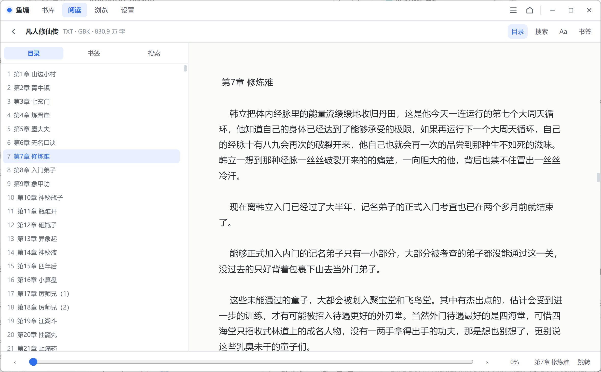

# 鱼塘 · desk-chill

**A lightweight, dockable desktop viewer. Quick hide hotkey for your desk chill time.**

**轻量贴边阅览工具，支持老板键一键隐藏，工位小憩。**

---


「鱼塘」是一个把**本地阅读器**、**贴边收起**、**内置浏览器**和**老板键**装进同一个窗口的 Windows 桌面工具。

工作间隙想看两页小说、翻翻收藏的长文，又不想在任务栏留下一排痕迹——  
把它往屏幕边缘一贴，只剩一条 4px 的细线；按一下 `F8`，窗口连同任务栏入口一起消失。

> One window that reads your local TXT/PDF library and browses the web. Dock it to a screen  
> edge and it collapses into a 4px strip; press `F8` and it vanishes from the taskbar.  
> Everything stays on your machine — no account, no cloud, no telemetry.

*名字来源：摸鱼的地方，叫鱼塘。*

---

## 界面预览



*阅读：左侧章节目录跟随滚动高亮，正文连贯滚动，进度精确到章内字符位置。*


*浏览：内置 Chromium，多标签、地址栏、快捷入口，登录态在同一次运行内保留。*

---

## 为什么是「一个窗口」

大多数摸鱼方案要么是纯阅读器（看不了网页），要么是改过的浏览器（藏不住）。  
鱼塘把两件事合成一个可隐藏的窗口，并让窗口本身成为「可以贴边收纳的物件」：

- **阅读时**是阅读器：无边框、无账号、无同步，只要一个 TXT / PDF。
- **想看网页时**切一个标签，内置 Chromium 直接渲染，登录态留住。
- **有人过来时**按 `F8` 或让鼠标移开——窗口缩成边条或整体消失，不占任务栏。
- **全程离线优先**：书库、进度、设置、日志全部只落在本机 `%APPDATA%`，没有账号体系、没有云端。

---

## 功能特性

### 本地阅读器（TXT / PDF）

| 能力           | 说明                                                                                    |
| ------------ | ------------------------------------------------------------------------------------- |
| **TXT 连贯滚动** | 主流阅读器交互：正文是一条连续长流，章节标题作为分隔。按章节分块 + 可视区前后各预载 2 块 + 双向追加/回收，**830 万字实测约 0.7s 打开**，滚动不掉帧 |
| **滚轮两种模式**   | 默认「连贯滚动」（网页式，滚轮即滚），设置里可切换「整屏翻动」（带缓动动画）                                                |
| **编码自动识别**   | UTF-8 / UTF-16LE / UTF-16BE / GBK / BIG5，BOM 优先、严格 UTF-8 校验、chardet 采样兜底；识别错可手动换编码    |
| **PDF**      | pdf.js 逐页 canvas 渲染，IntersectionObserver 懒加载；文本层可选中复制、可全文搜索                           |
| **排版可调**     | 字号、行距、字体、四种背景（白 / 米 / 护眼 / 暗），行宽上限 760px 居中，超宽屏不拉成横幅                                  |
| **章节目录**     | 自动识别「第 X 章 / 序章 / 楔子…」，目录跟随滚动高亮，点击按字符偏移精确跳转                                           |
| **书签与搜索**    | 书签记录全局字符偏移（±600 字视为同一处），全文搜索命中后直接滚到位置                                                 |
| **精确续读**     | 进度按「视口顶部字符偏移」保存（节流 1s + 原子写入），重开书回到原位置，不是回到章首                                         |

### 贴边收起

- 窗口拖到屏幕左 / 右 / 上边缘松手 → 收成 **2–8px 可调**的边条
- **鼠标移到边条自动展开，移开自动收回**；展开位置吸附在边缘，不会跳回屏幕中央
- 展开后拖动窗口或最大化即取消自动收起；也可「固定展开」保持常开
- 方向、动画时长可调，重启恢复上次贴边状态

### 窗口置顶（钉在最上层）

- 顶栏**图钉按钮**一键置顶，窗口浮在其他程序之上，切到别的窗口也不被盖住
- **与贴边收起互斥**：置顶时拖到边缘不吸附、「收成边条」按钮会解释原因；一旦收成边条则自动取消置顶 —— 不会出现「既贴在屏幕外、又浮在最上层」
- 三个入口同一个开关：顶栏图钉 / 托盘菜单「窗口置顶」/ 设置页复选框，状态实时同步并记住到下次启动
- 贴边动画期间会临时提高窗口层级，动画结束按你的置顶意愿回落，反复贴边不会把置顶弄丢
- 置顶层级用 `floating`（等价 Windows `HWND_TOPMOST`），不会盖住 UAC 弹窗与任务栏

### 内置浏览器

- Chromium（`WebContentsView`）渲染，多标签，**每个标签自带 × 关闭**
- 地址栏支持 URL 直连与关键词搜索，前进 / 后退 / 刷新 / 缩放
- 快捷入口默认 **B站 / 小红书 / 知乎 / 微博 / 抖音**（可编辑）
- 会话持久化（`persist:` 分区），同一次运行内保留登录态
- **错误页带错误码与中文原因**：断网 / 证书 / DNS 失败都能看清问题，可重试、可清缓存重试、可交给系统浏览器
- **客户端协议拦截**：`bytedance://`、`weixin://`、`snssdk1128://` 这类链接默认在应用内提示，不再弹出「请在 Microsoft Store 中查找」；确实需要时可点「用系统打开」
- 网络可调：代理跟随系统 / 直连 / 手动，真实 Chrome UA，可关闭 QUIC，证书错误可选信任

### 老板键与托盘

- 全局热键默认 `F8`，可自定义，注册冲突会明确提示
- 按下后窗口 + 任务栏入口一起消失，只留托盘图标；再按恢复隐藏前的状态（展开或贴边都行）
- 托盘菜单退出需二次确认，退出前强制保存进度

### 响应式布局

窗口在 520×380 到全屏之间任意长宽都能用：宽度 ≤900px 侧栏变抽屉，≤720px 收紧顶栏，≤600px 收掉次要信息，高度 ≤620px 压缩纵向留白。四组断点均无横向滚动。

---

## 快速开始

### 直接使用（普通用户）

从 [Releases](https://github.com/Finch-Hub/desk-chill/releases) 下载：

| 文件                      | 说明                          |
| ----------------------- | --------------------------- |
| `鱼塘-0.1.0-x64.exe`      | 安装向导版（桌面快捷方式 + 开始菜单 + 卸载入口） |
| `鱼塘-0.1.0-portable.exe` | 便携版，单文件双击即用                 |

> 程序未做代码签名，Windows Defender / 360 等可能误报。个人使用可加白名单；对外分发建议购买签名证书。

### 从源码运行（开发者）

要求：**Node.js 18+**、Windows 10/11。

```bash
git clone https://github.com/Finch-Hub/desk-chill.git
cd desk-chill
npm install
npm start          # 启动
npm run dev        # 启动 + DevTools
```

常用校验命令：

```bash
npm run check      # 渲染层 ESM 语法预检
npm run test:dock  # 贴边状态机单测（无需 GUI，可控时钟 + 可控光标）
npm run test:url   # 浏览器 URL 守卫单测（协议放行/拦截）
npm run typecheck  # tsc --noEmit + 上面三项
```

> 若 `node_modules/electron/path.txt` 不存在（`npm install` 时 Electron 二进制未下载），执行：  
> `node node_modules/electron/install.js`（国内可先设 `ELECTRON_MIRROR=https://npmmirror.com/mirrors/electron/`）

---

## 使用方式

1. **导入书**：`Ctrl+O` 选 TXT / PDF，或把文件拖进窗口。
2. **开始读**：左侧目录点章节，或直接滚轮滚动；进度自动保存，下次打开原位置。
3. **贴边**：把窗口拖到屏幕左/右/上边缘松手，它会自己收起来，鼠标移上去再展开。
4. **藏起来**：按 `F8`。

### 快捷键

| 键                                                                 | 作用                                     |
| ----------------------------------------------------------------- | -------------------------------------- |
| `F8`                                                              | 老板键：隐藏 / 恢复（可改）                        |
| `Ctrl+1` / `Ctrl+2` / `Ctrl+,`                                    | 书库 / 浏览 / 设置                           |
| `Ctrl+O`                                                          | 导入文件                                   |
| `PgUp` / `PgDn` / `空格`                                            | 整屏翻动（连贯滚动模式下滚轮即滚）                      |
| `Home` / `End`                                                    | 跳到文首 / 文末                              |
| `Ctrl+=` / `Ctrl+-`                                               | 字号加减                                   |
| `Ctrl+F`                                                          | 全文搜索（阅读）/ 页内查找（浏览）                     |
| 浏览器内 `Ctrl+T` / `Ctrl+W` / `Ctrl+L` / `Ctrl+R` / `Ctrl+=` `-` `0` | 新标签 / 关标签 / 聚焦地址栏 / 刷新 / 缩放（焦点在网页里也生效） |
| `Esc`（浏览）                                                         | 关查找条，否则回阅读（焦点在网页里也生效）                  |

---

## 数据与隐私

所有数据落在 `%APPDATA%\desk-chill\`，**没有账号、没有云端、埋点不上传**：

```
%APPDATA%\desk-chill\
├── data\
│   ├── library.json    书库
│   ├── progress.json   阅读进度 + 书签
│   ├── settings.json   设置
│   └── window.json     窗口与贴边状态
└── logs\
    └── YYYY-MM-DD.log  本地日志（按日轮转，保留 30 天）
```

四个 JSON 均为**原子写入**（临时文件 + rename），断电不写坏。数据目录固定为英文路径，升级或改名不丢数据。

---

## 项目结构

```
desk-chill/
├── src/
│   ├── main/                    主进程（CommonJS）
│   │   ├── main.js              窗口 / IPC / 托盘 / 老板键 / 浏览器视图
│   │   ├── dock.js              贴边状态机（NORMAL / DOCKED / PEEKING / PINNED）
│   │   ├── book.js              TXT 编码检测 + 章节识别，PDF 索引
│   │   ├── store.js             原子读写 %APPDATA%/desk-chill
│   │   ├── urlguard.js          浏览器协议白名单 / 客户端协议拦截
│   │   ├── preload.js           contextBridge 暴露的 IPC 面
│   │   └── home.html            新标签页
│   ├── renderer/                渲染层（原生 ES Module，无框架）
│   │   ├── index.html
│   │   ├── styles.css
│   │   └── js/
│   │       ├── app.js           视图切换与全局事件
│   │       ├── reader.js        TXT 连贯滚动引擎 + PDF 渲染
│   │       ├── library.js       书库
│   │       ├── browser.js       浏览器工具栏与标签
│   │       ├── settings.js      设置面板
│   │       ├── state.js         共享状态与工具函数
│   │       └── ui.js            toast / modal
│   ├── assets/                  图标（icon.png / icon.ico / tray.png，脚本生成）
│   └── vendor/pdf/              pdf.js 运行资源（cmaps、标准字体）
├── scripts/                     e2e 与自检脚本
├── doc/                         产品文档（PRD、分析报告）
└── assets/                      README 配图
```

**技术选型**：Electron 33 + 原生 ES Module，渲染层零框架依赖。理由是这个应用 90% 的复杂度在「窗口行为 + 大量文本的渲染性能」，框架帮不上忙，反而会拖慢首屏。依赖只有两个：`pdfjs-dist`（PDF 渲染）和 `chardet`（编码猜测）。

### 自检脚本（e2e）

```bash
MOYU_E2E=1        npm run dev   # 书库 / 阅读 / PDF / 贴边 + 15MB 大文件专项
MOYU_E2E_BROWSER=1 npm run dev  # 浏览器专项（导航 / 查找 / 标签 / 错误页 / 真站点）
MOYU_E2E_LAYOUT=1  npm run dev  # 响应式布局专项（8 组长宽 × 4 视图，查横向溢出）
MOYU_E2E_NET=1     npm run dev  # 网络专项（自签名证书站 + 真站点 + 信任证书开关）
MOYU_E2E_FLOW=1    npm run dev  # TXT 连贯滚动专项（分块 / 追加 / 位置还原）
MOYU_E2E_SHOTS=1   npm run dev  # 重新生成 README 配图到 assets/（用临时 user-data-dir 跑）
MOYU_E2E_ICON=1    npm run dev  # 图标自检（顶栏 logo / 任务栏按钮 / 托盘位置，截图落 .shots/）
MOYU_E2E_SIDE=1    npm run dev  # 目录侧栏专项（宽度拖拽 / 越界钳制 / 点正文收起 / 窄窗抽屉）
MOYU_E2E_PIN=1     npm run dev  # 窗口置顶专项（图钉 / 落盘 / 设置页同步 / 贴边两轮后仍置顶）
```

图标由 `scripts/make-icon.js` 从一张正方形插画自动抠底、裁主体、生成多尺寸 png/ico：

```bash
node_modules\electron\dist\electron.exe scripts\make-icon.js <源图>
```

截图落在 `.shots/`。跑 e2e 建议加 `--user-data-dir` 指向临时目录，避免污染真实书库、也避免单实例锁让新实例静默退出。

---

## 打包

```bash
npm run build:win   # dist/ 下产出 NSIS 安装包 + 便携版 exe
npm run build:dir   # 仅输出未打包目录（调试用）
```

---

## 已知限制

- **PDF 大纲依赖文件自带书签**；扫描版 PDF 无文本层时不能搜索 / 复制
- **贴边是「驻留式」的**：防人眼不防企业网络审计，本项目不对抗审计
- **浏览器登录态只在同一次运行内保留**，退出应用即清会话
- **仅 Windows**：贴边、老板键、任务栏行为都基于 Win32 窗口 API
- 默认关闭 GPU 加速（`disable-gpu` + `disable-gpu-compositing` + `disable-gpu-sandbox`），规避部分显卡驱动下图形上下文创建失败的崩溃；阅读类 UI 无感知
- 内置浏览器渲染进程使用 `sandbox: false` + `contextIsolation: true` + `nodeIntegration: false`：本机环境下开 `sandbox: true` 会启动即崩，远程网页依旧拿不到 Node 能力
- 窗口最小尺寸 520×380

---

## 文档

全部产品文档在 [`doc/`](doc/) 目录：

| 文件                                | 内容                         |
| --------------------------------- | -------------------------- |
| [`doc/README.md`](doc/README.md)  | 功能细节、已知边界、FAQ（网页打不开的排查顺序等） |
| `摸鱼一体工具 MVP PRD（产品方案 v0.1）.md`    | P0 四件套的需求定义与验收标准           |
| `摸鱼一体工具（阅读器＋轻量浏览器＋贴边收起）产品分析报告.md` | 竞品与场景分析                    |
| `桌面阅读器PRD.md`                     | 阅读器模块的早期设计稿                |

---

## License


本项目基于 [MIT License](LICENSE) 发布，Copyright (c) 2026 Finch-Hub。

> 项目仅用于个人学习与自用。请遵守所在单位的工作制度与网络使用规定。
